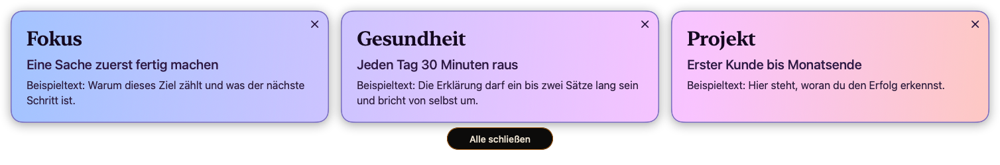
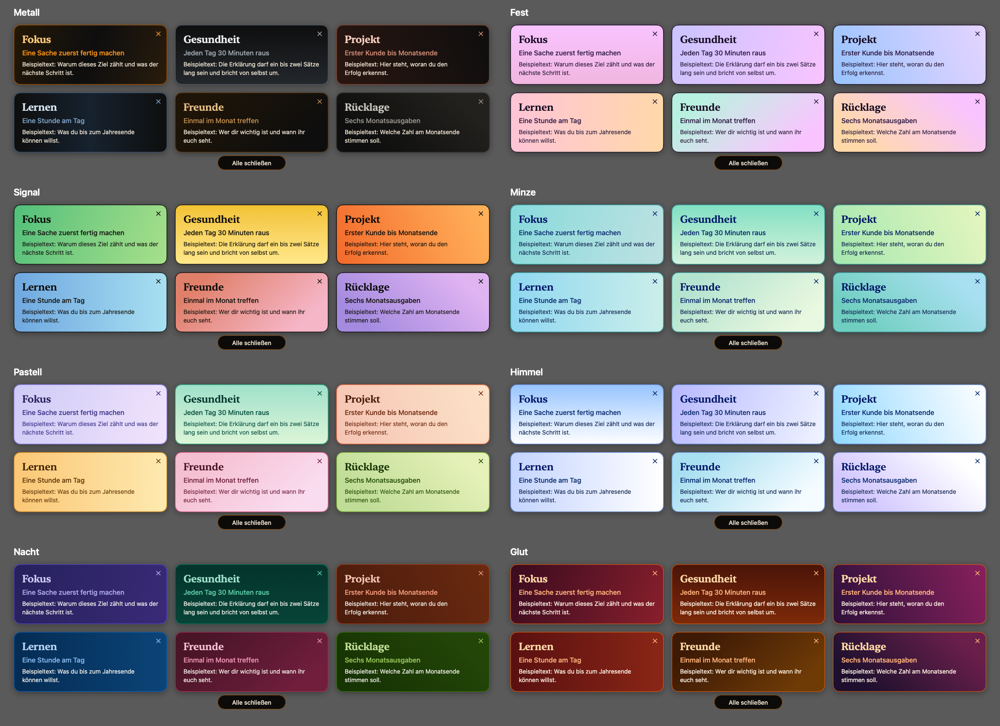
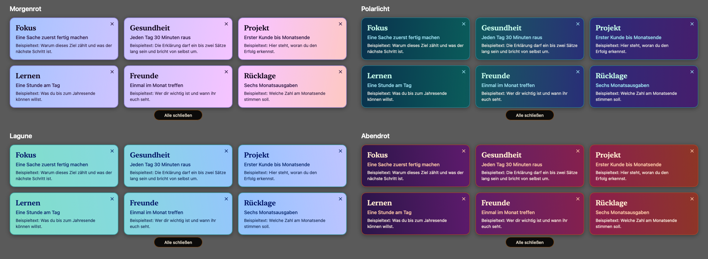

# Goals

Die Goal-App für macOS legt deine Ziele in einem einstellbaren Takt als Zielanzeigen über alles, was gerade auf dem Bildschirm läuft. Die Zielanzeigen bleiben ein paar Sekunden stehen und verschwinden wieder von selbst. Dein aktives Programm behält dabei den Fokus, du kannst einfach weitertippen.

Projektseite: <https://librarycompass.com/goals/>




## Was die Goal-App kann

- **Zielanzeigen** mit Überschrift, Unterüberschrift und Erklärung, jede einzeln ein- und ausschaltbar. Eine einzelne Zielanzeige steht allein, mehrere stehen gemeinsam in einem automatischen Raster.
- **Vier Größen:** 360, 480, 640 und 900 pt Breite. Passt das Raster nicht auf den Bildschirm, nimmt die Goal-App die nächstkleinere Größe.
- **Takt:** alle 1 Min., 15 Min., 30 Min., 1 Std., 2 Std., 4 Std. oder ein eigener Wert. Er zählt ab dem Verschwinden der Zielanzeigen. Wahlweise streut er um ± 20 %: Bei 15 Minuten liegen dann 12 bis 18 Minuten zwischen zwei Anzeigen. Das Menü nennt die Zeit bis zur nächsten Erinnerung.
- **Anzeigedauer:** 5, 10, 15 oder 30 Sekunden für alle Zielanzeigen gleichzeitig.
- **Wegklicken:** X je Zielanzeige, ab zwei Zielanzeigen zusätzlich „Alle schließen“.
- **Farbe:** einfarbig in Bitcoin-Orange auf Dunkel, oder farbig mit Verläufen. Acht Schemen geben jeder Zielanzeige einen eigenen Verlauf: Metall, Signal, Pastell, Nacht, Fest, Minze, Himmel, Glut. Vier Schemen legen einen einzigen Verlauf über alle Zielanzeigen zusammen: Morgenrot, Lagune, Polarlicht, Abendrot. Dazu kommen eigene Farben je Zielanzeige.
- **Ort:** Mitte des Hauptbildschirms, per Ziehen verschiebbar, die Position bleibt gespeichert.
- **Aufzeichnung:** Das Fenster verlangt von macOS, nicht in Bildschirmfreigaben und Aufnahmen zu erscheinen (`NSWindow.sharingType = .none`). Verlass dich nicht darauf: In den Apple Developer Forums wird berichtet, dass die Aufnahme von QuickTime solche Fenster trotzdem erfasst. Prüfe es mit deinem Programm, siehe `--show-for` in [docs/ENTWICKLUNG.md](docs/ENTWICKLUNG.md).
- Bei gesperrtem Bildschirm, Bildschirmschoner und im Ruhezustand erscheint nichts. Ein fälliger Termin folgt beim Entsperren.


## Bedienung

Das Symbol in der Menüleiste, das Dock-Symbol und der Rechtsklick auf eine Zielanzeige öffnen dasselbe Menü: Jetzt zeigen, Zielanzeigen, Größe, Anzeigedauer, Takt, Farbe, Position zurücksetzen, Einstellungen, Autostart, Beenden. Ein Klick auf das Dock-Symbol öffnet die Einstellungen.

Ab Werk gilt: Größe „Mittel“ (480 pt), 15 Sekunden Anzeigedauer, Takt 1 Stunde ohne Streuung, einfarbig. Ein eigener Takt darf zwischen 1 Minute und 24 Stunden liegen.

## Farben

Die Farbe wählst du im Menü unter „Farbe“ oder im Einstellungsfenster im Bereich „Anzeige“.

**Verlauf je Zielanzeige:** Jedes dieser acht Schemen hat sechs verschiedene Verläufe, ab der siebten Zielanzeige wiederholen sie sich.



**Verlauf über die ganze Fläche:** Diese vier Schemen legen einen einzigen Verlauf über alle Zielanzeigen. Jede Zielanzeige zeigt ihren Ausschnitt, die Lücken zwischen den Zielanzeigen bleiben durchsichtig. Eine Zielanzeige allein zeigt den ganzen Verlauf.



**Eigene:** Hintergrund, Überschrift und Text stellst du je Zielanzeige im Bereich „Zielanzeigen“ ein. Diese Zielanzeigen und die einfarbige Darstellung haben keinen Verlauf.

## Die Datei

Die Zielanzeigen liegen lesbar in `~/Library/Application Support/Goals/goals.json`. Änderungen von außen wirken sofort, auch von Editoren, die atomar speichern. Treffen sie auf eine ungespeicherte Eingabe in der Goal-App, gewinnt die Datei. Eine Datei, die nicht lesbar ist, bleibt unangetastet: Die Goal-App meldet das und speichert nichts, bis sie wieder lesbar ist. Löschst du die Datei, schreibt die Goal-App den letzten guten Stand zurück.

```json
{
  "cards": [
    { "title": "Fokus", "subtitle": "Eine Sache zuerst fertig machen", "detail": "Warum dieses Ziel zählt." },
    { "title": "Gesundheit", "enabled": false }
  ],
  "version": 1
}
```

Alle Schlüssel außer `cards` sind freiwillig. Eigene Farben stehen je Zielanzeige unter `colors` mit `background`, `title` und `text` als Hex-Wert. Unbekannte Schlüssel gehen beim nächsten Speichern in der Goal-App verloren.

## Bauen

Voraussetzung: macOS 14 oder neuer und Xcode.

```bash
bash Scripts/build_local_app.sh
```

Das Skript baut die Goal-App, signiert ad hoc, installiert nach `/Applications` und startet die Goal-App. Beim ersten Start öffnet sich das Einstellungsfenster mit einer ausgeschalteten Beispiel-Zielanzeige, und die Goal-App trägt sich als Anmeldeobjekt ein.

## Prüfen

```bash
swift test
/Applications/Goals.app/Contents/MacOS/Goals --selftest
/Applications/Goals.app/Contents/MacOS/Goals --snapshot /tmp/goals-bilder
```

`--selftest` läuft rund 10 Sekunden im echten Fenster mit einer Wegwerf-Datei und gibt JSON aus. Aufbau, alle Prüfungen und Fallen: [docs/ENTWICKLUNG.md](docs/ENTWICKLUNG.md). Der Stand je Version steht in [CHANGELOG.md](CHANGELOG.md).

## Entfernen

Schalte zuerst im Menü den Autostart aus und beende die App. Danach entfernen diese Befehle die App, deine Zielanzeigen und die Einstellungen:

```bash
rm -rf /Applications/Goals.app
rm -rf ~/Library/Application\ Support/Goals
defaults delete com.joemartinbtc.Goals
```

## Lizenz

MIT
