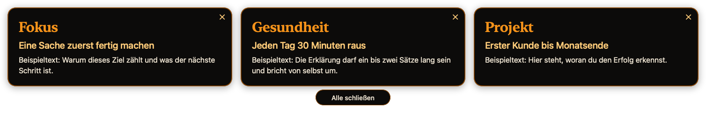
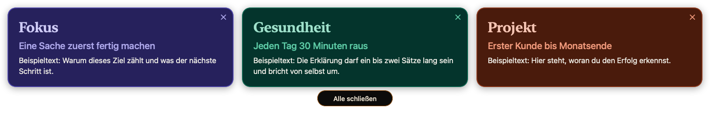
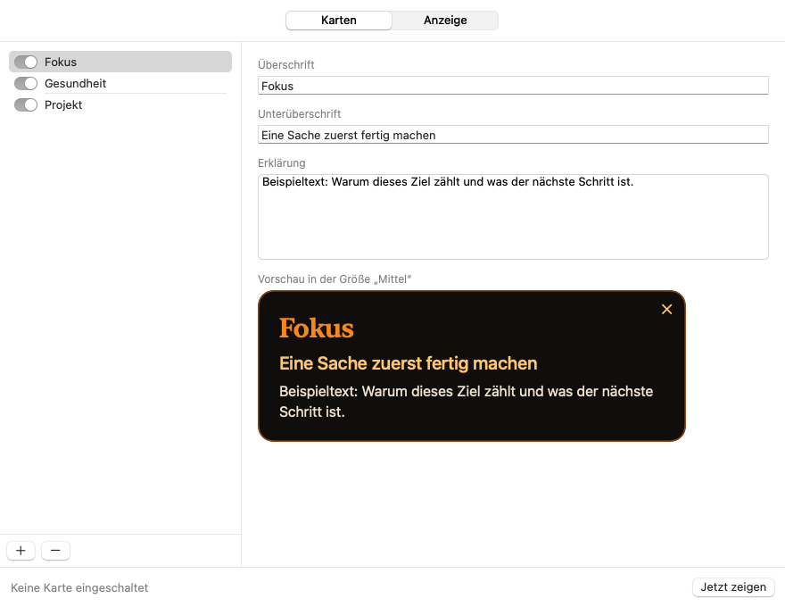

# Goals

Native macOS-App, die deine Ziele in einem einstellbaren Takt als Karten über alles legt, was gerade auf dem Bildschirm läuft. Sie bleiben ein paar Sekunden stehen und verschwinden wieder von selbst. Dein aktives Programm behält dabei den Fokus, du kannst einfach weitertippen.





## Was sie kann

- **Goal-Karten** mit Überschrift, Unterüberschrift und Erklärung, jede einzeln ein- und ausschaltbar. Eine einzelne Karte steht allein, mehrere stehen gemeinsam in einem automatischen Raster.
- **Vier Größen:** 360, 480, 640 und 900 pt Breite. Passt das Raster nicht auf den Bildschirm, nimmt die App die nächstkleinere Größe.
- **Takt:** alle 15 Min., 30 Min., 1 Std., 2 Std., 4 Std. oder ein eigener Wert. Er zählt ab dem Verschwinden der Karten. Wahlweise streut er um ± 20 %.
- **Anzeigedauer:** 5, 10, 15 oder 30 Sekunden für alle Karten gleichzeitig.
- **Wegklicken:** X je Karte, ab zwei Karten zusätzlich „Alle schließen“.
- **Farbe:** einfarbig in Bitcoin-Orange auf Dunkel, oder farbig mit den Schemen Metall, Signal, Pastell, Nacht und eigenen Farben je Karte.
- **Ort:** Mitte des Hauptbildschirms, per Ziehen verschiebbar, die Position bleibt gespeichert.
- **Aufzeichnung:** Das Fenster verlangt von macOS, nicht in Bildschirmfreigaben und Aufnahmen zu erscheinen (`NSWindow.sharingType = .none`).
- Bei gesperrtem Bildschirm, Bildschirmschoner und im Ruhezustand erscheint nichts. Ein fälliger Termin folgt beim Entsperren.



## Bedienung

Das Symbol in der Menüleiste, das Dock-Symbol und der Rechtsklick auf eine Karte öffnen dasselbe Menü: Jetzt zeigen, Karten, Größe, Anzeigedauer, Takt, Farbe, Position zurücksetzen, Einstellungen, Autostart, Beenden. Ein Klick auf das Dock-Symbol öffnet die Einstellungen.

## Die Datei

Die Karten liegen lesbar in `~/Library/Application Support/Goals/goals.json`. Änderungen von außen wirken sofort, auch von Editoren, die atomar speichern. Eine Datei, die nicht lesbar ist, bleibt unangetastet: Die App meldet das und speichert nichts, bis sie wieder lesbar ist.

```json
{
  "cards": [
    { "title": "Fokus", "subtitle": "Eine Sache zuerst fertig machen", "detail": "Warum dieses Ziel zählt." },
    { "title": "Gesundheit", "enabled": false }
  ],
  "version": 1
}
```

Alle Schlüssel außer `cards` sind freiwillig. Eigene Farben stehen je Karte unter `colors` mit `background`, `title` und `text` als Hex-Wert.

## Bauen

Voraussetzung: macOS 14 oder neuer und Xcode.

```bash
bash Scripts/build_local_app.sh
```

Das Skript baut die App, signiert sie ad hoc, installiert sie nach `/Applications` und startet sie. Beim ersten Start öffnet sich das Einstellungsfenster mit einer ausgeschalteten Beispielkarte, und die App trägt sich als Anmeldeobjekt ein.

## Prüfen

```bash
swift test
/Applications/Goals.app/Contents/MacOS/Goals --selftest
/Applications/Goals.app/Contents/MacOS/Goals --snapshot /tmp/goals-bilder
```

`--selftest` läuft rund 15 Sekunden im echten Fenster mit einer Wegwerf-Datei und gibt JSON aus. Aufbau und Fallen: [docs/ENTWICKLUNG.md](docs/ENTWICKLUNG.md).

## Lizenz

MIT
